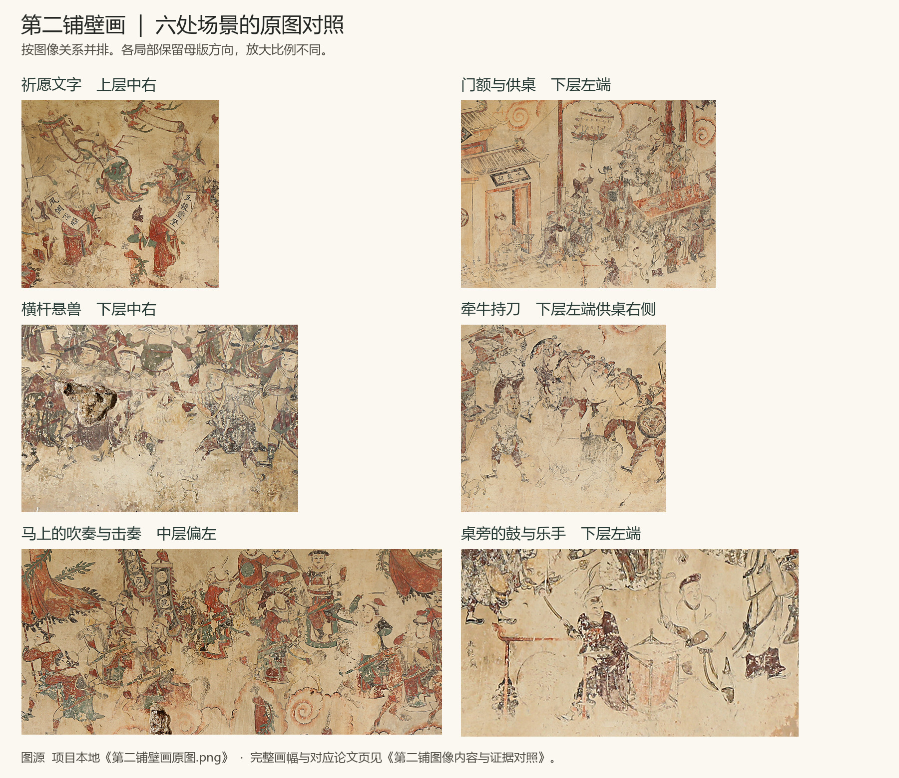

# 第二铺图像内容与证据对照

[打开母版，17507 × 3960](../../../水龙祠壁画素材/壁画原图/第二铺壁画原图.png) · [打开模块B高清图，8192 × 1853](../../../Mural-Exhibition/public/gallery/mural-02-detail.webp)

先在全幅上认出左下门额、上层车轮、两层云带以及中右暗斑，再将局部与论文照片对读。两份本地图像方向一致，代表同一画面。下表的左右是照片方位，前列指队伍在画中的位置。**确认**用于看得见的形态、题字或位置；**较有依据**用于有具体图版或比较材料的文献考释；**推测**用于有解释力但缺少直接识别依据的判断；**待核实**指出现有资料不能解决的问题。同一行的观察与命名可以有不同等级。文献栏数字为**正文页／PDF物理页**，完整题名和本地链接见[原文索引](07_第二铺整体仪式主题研究.md)。

图中每行是一组对照。母版等比截取，未翻转、补绘或调整色调。中排左的损失恰在杆与兽身相接处，右图的牛则在人的手和供桌附近。下排的差别在动作发生的地点：一组乐手随马队移动，另一组围着祠前的鼓。局部相似的题材，须放回各自的邻近人物中解释。

## 上层　谁受到簇拥，谁在前导

| 对象与位置 | 母版可见特征 | 文献称谓与出处 | 叙事作用及判断 |
|---|---|---|---|
| 车辇及乘者，上层中右至右端 | 各车的轮、辕、座位和牵引关系可循；个别轮廓没入暗斑，右端仍见带顶车与坐者。相邻者骑、步相杂。 | 刘灿姣、林伟20／3；胡彬彬、吴灿23／2，图4、6在PDF 11；李济民121／6图15 | **确认**车组及随从；四辇是调查记录。车中人物被周围人、伞盖和旗号区别出来，**较有依据**读作神祇出行的仪卫。车数与座次尚不足以定每位名号。 |
| 女性乘者与侍从，上层靠近白幡的车旁 | 可辨乘者、随行者的不同装束和回首动作；所持伞盖随核心人物移动。 | 胡、吴23／2，图6；陈勤学115–116、120／2–3、7图1–2区分八人组与四人组 | **较有依据**为受到礼遇的女性群像。陈将两组主神分别联系西王母、婆王，均属**推测**。其图3左下执剑者与李仙娘的联系另据地方口述，不能移到车上。 |
| 旗、华盖、执事，上层各群 | 多面旗高出人头，盖面集中在若干骑者、乘者上方。旗杆之间有持物步行者。 | 胡、吴23／2；杨会娟、刘灿姣113／2图6标示华盖；邓昶117／2图2辨旗纹 | **确认**反复出现的标识及围绕关系；**推论**为观看者辨别仪仗与主从提供线索。旗纹残缺处不能补齐四方神兽，也不能据盖数点出同数神名。 |
| 持刀骑者与骑虎者，上层中段偏左 | 一人绿袍、持长柄兵刃骑马；另一人骑有条纹的兽、举持物，两人处于不同旗盖与随行者之间。 | 邓昶116–117／1–2图1；杨、刘112–113／1–2图2（赵公明）、图3（关公）；林妙璇48–49／58–59 | **确认**坐骑、持物及相对位置；分别辨为关帝（关元帅）与赵公明（赵元帅）**较有依据**。根据服色、兵刃、坐骑同已知神像比较，未见两人各自可读的姓名题记。 |
| 两位展条幅者及带翼人物，上层中右 | 白底文字可读「風調雨順」「五穀豐登」，两人之间的上方有双翼形轮廓；文字对向展开。 | 胡、吴23／2，图5在PDF 11；邓昶117／2图1辨雷公；彭迪等115–116／2–3联系祈雨 | **确认**两项愿望，**较有依据**辨带翼者为雷公。字幡给全画留下可核对的祈愿内容。翼形者是否正向二人赐福、是否在另一层再现，均属**推测**。 |
| 领队与倒立者，上层左端 | 持锣、持角形物、举树木状物和倒立者相邻。动作的高低、节奏与后方整列步态有别。 | 胡、吴23／2早释「山精树怪」；吴灿123–124／5–6修订；刘灿姣、杨会娟53–55／6–8，彩插PDF 2–3图1–9；李济民121／6图20–21 | **确认**动作及前列位置；倒立者释张五郎、旁列释五猖或梅山猖兵**较有依据**。恭城画本有榜题，本墙未见对应姓名。富川「跳五猖」可解释前导功能；每个人是否扮演同样节目**待核实**。 |

## 中层　队列怎样既有威仪又有乐声

| 对象与位置 | 母版可见特征 | 文献称谓与出处 | 叙事作用及判断 |
|---|---|---|---|
| 骑者、步行者与执械者，中层横贯全幅 | 马首和跨步多朝左，骑步错落成群；仪仗长杆、长刀与叉状物伸出人列，部分人物回头或正面示人。 | 刘灿姣、林伟20／3；贺景卫、彭迪117／2表1及图2；程旭蕊30／39图2-27 | **确认**队伍有组织的行进动势；兵将服饰与执械分工**较有依据**。单凭向左不能给每组标出先后时刻。 |
| 持牌、掌旗与持扇者，中层左段及各组 | 左段牌成对高举，若干人同样把展开的扇举在胸前；另见军令式窄旗。 | 胡、吴23／2，图7在PDF 11，读「肃静」「回避」「三军号令」；吴灿121–123／3–5；贺、彭119／4图6 | **确认**持牌、执扇和成列。肃静、回避的文字与前导执事的作用相合；军傩扇阵、戏曲道具均为**文献考释**。各扇画题或特定剧目**待核实**。 |
| 马上的吹奏与击奏，中层偏左 | 器物横举至唇边，另有人面对圆形打击器抬起手臂；马匹、骑手及相邻持械者处于同一行列。 | 程旭蕊26／35图2-19（作者自摄，图2-20属第一铺）；贺、彭118–119／3–4图5；郑富天110／118图3-27（分组线描） | **确认**骑马演奏；文献据唢呐、号、锣鼓等辨多种乐手。音乐可为整队开道、伴行、壮仪，属**有依据的功能解释**。音响、曲谱、固定人数和当日演奏次序无法由静图复原。 |
| 伴乐的持刀、支伞者，骑马乐队周围 | 乐器旁仍有刀柄、竖杆及举持动作，人物与马互有遮挡。 | 郑富天110／118图3-27及编号B148–159；林妙璇14、34／24、44 | **确认**不同持物同组出现。郑的分组把吹奏、击奏者同持刀、持伞者区分；图中12位编号不能统算成12位乐手。部分角色可以兼具仪仗与护从职能。 |
| 前列脚与建筑，中层最左 | 持叉者的脚贴近下方屋顶轮廓，云带在屋边转折。 | 胡、吴23／2；郑富天43、86–87／51、94–95 | **确认**跨层邻接；它把中层队伍带到下层场所的上方。**推测**队伍正在接近目的地；没有可以循此接点从上层逐人追到下层的身份标志。 |

## 下层　行进如何和祠前活动发生关系

| 对象与位置 | 母版可见特征 | 文献称谓与出处 | 叙事作用及判断 |
|---|---|---|---|
| 骑步兵、旗号及持物者，下层中部及两侧 | 骑者夹在步行组中，刀、长杆、旗、扇与犬形小兽反复出现，至右部有孔洞及遮黑。 | 刘灿姣、林伟20／3；林妙璇15／25记「三军司令」；胡、吴23／2 | **确认**下层仍有仪仗，分层没有把兵、神、民截然分开。中层文献另记「三军号令」；跨铺「敕封水龙祠／庙」在邓昶117／2与杨、刘113／2图4图说之间有出入，相关牌号逐件释字**待核实**。 |
| 扛杆抬兽者，下层中右、暗斑左侧 | 兽身悬在横杆下，后方负重者轮廓较清，前方人物和接合处残缺，邻近有小型犬形。 | 胡、吴23／2「挑牲口」，图9在PDF 12；程旭蕊26／35图2-18自摄；郑富天119／127图3-37；李济民121／6图19称猎人扛麋鹿 | **确认**负重与悬兽；民众、猎人分别是据衣着或联系狩猎习俗的称谓。所抬之物可能是供献来源，属**推测**；种属、职业与去向**待核实**。把它称为祠前那头牛会给图像强加同一性。 |
| 祠门、屋宇与门侧人物，下层左端 | 屋顶、门阶、围墙和门额合成可辨建筑，左侧一人俯身向地面伸长物，门洞另有人物。 | 李济民119–120／4–5图7、11；刘灿姣、林伟20／3及彭迪等116／3图5辨门边雷神 | **确认**门额指认画中水龙祠。俯身者被李释为司炮官，与门边神祇、桌旁鼓手为不同对象。人物行动提示局部时间，无法据此定整幅是在起驾还是回庙。 |
| 桌案、供物与端盘者，下层门前 | 长桌斜向展开，摆有盘碗、器皿、食物状轮廓；桌前数人端持方盘，桌后有人持幡或站立。 | 胡、吴23／2及PDF 12图8；龙明盛112–113／1–2图1辨猪头、鱼、鸡；郑富天115–116／123–124图3-33 | **确认**陈供与端持并见，区别人群的聚合和队列的通行。师公、侍者、官员及具体供品属**文献考释**。奉盘、迎候可据动作解释；接收者是谁、是否已完成交接**待核实**。 |
| 持刀牵牛者与相邻人群，下层左端供桌右方 | 一人臂部与绳、牛头构成斜向牵引关系，可辨长刀、兽体与邻近人物；有多处掉色。 | 龙明盛112–113／1–2图1–2称「砍牛图式」；廖方容21／4；李济民119／4图10称「椎牛献祭」 | **确认**牵牲、持刀及位置。解释为准备砍牛**较有依据**。龙文描述刀斜向下、廖称欲举刀，画面没有展现完成后的状态；现场横木在图中未辨。 |
| 桌旁击鼓者，下层左端桌下方 | 两人、鼓身及手部动作成一小组，站位在供桌近处，与马上的吹打者相距明显。 | 程旭蕊26／35图2-21自摄，郑富天116／124图3-33及配文称乐师 | **确认**祠前也有奏乐者。程据衣着、朝向释为服务砍牛仪式，属**较有依据的解释**。两处音乐可以互相呼应；是否同曲、先后接奏或同一队人**待核实**。 |

### 照片、重绘和缺损各能说明什么

上层神名有助于理解哪些神祇进入画中群体，分工则要看谁骑乘、谁掌盖、谁迎候。带翼人物的神名也不能自动证明跨层同一人沿时间线走到祠门。局部命名还有一处实质出入：刘灿姣、杨会娟辨西门谢五猖、北门雷五猖，彭迪等115／2用「西门雷武猖」。两说依靠的比对图式不同，倒立姿态比这组方位实名更容易反复核对。

对骑马乐队，以照片确认群组，线描用来理解作者的人数与分组；对砍牛，优先核供桌、持刀者与牛的相对位置；对横杆，前人局部里的掉色与本地照片相符。暗斑、孔洞、擦损处均限制逐人辨认。本表保留可重复观察的位置，未据邻近人物补出残缺形象。
